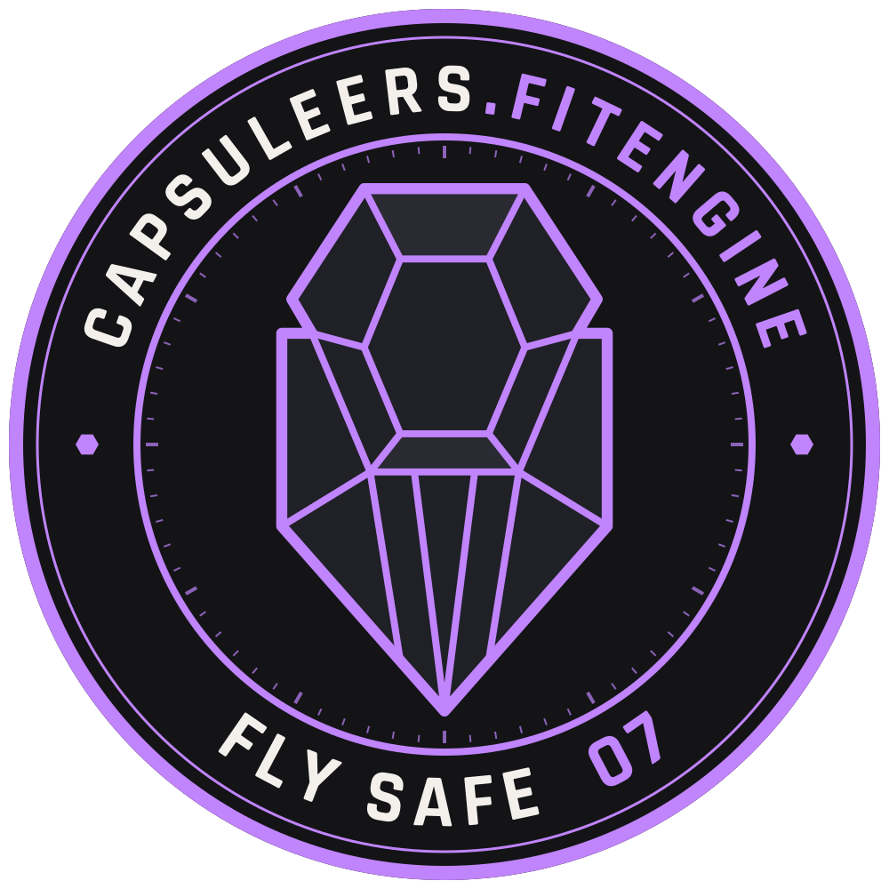

<p align="center"></p>

# capsuleers.fitting-engine-go

A **Pyfa-parity** EVE Online ship & Upwell-structure fitting calculation engine for **Go**, by
[capsuleers.app](https://capsuleers.app). Given a fit and an SDE dataset, it returns the full derived
stat block you'd see in a fitting tool: offense (DPS / alpha / application), defense (EHP / resists /
tank), capacitor (stability / simulation), navigation, targeting, fitting (CPU / PG / calibration),
projected effects, and structure fuel/service stats.

It is the Go twin of the npm package
[`eve-fit-engine`](https://github.com/capsuleers-app/capsuleers.fitting-engine): same engine, same
versions, same SDE data. The two are **peers**: each one is validated against Pyfa on its own, and every
parity fix lands in both.

> **Licence: GPL-3.0-or-later.** This engine is a derivative work of
> [pyfa-org/Pyfa](https://github.com/pyfa-org/Pyfa) and is distributed under the same terms. See
> [`NOTICE`](./NOTICE) and [`LICENSE`](./LICENSE). The complete corresponding source is this repository.

## Install

```bash
go get github.com/capsuleers-app/capsuleers.fitting-engine-go@latest
```

No dependencies outside the Go standard library.

## Usage: zero-config (embedded SDE)

Package `fitengine/bundle` embeds a snapshot of the EVE SDE (`data/`, ~8 MB, via `go:embed`). Give it an
EFT string, get full stats:

```go
import "github.com/capsuleers-app/capsuleers.fitting-engine-go/fitengine/bundle"

res, err := bundle.ComputeFromEft(`[Rifter, My Fit]
200mm AutoCannon II, Republic Fleet EMP S
200mm AutoCannon II, Republic Fleet EMP S
1MN Afterburner II
Gyrostabilizer II
`, nil)
if err != nil { /* ... */ }
d := res.Computed.Derived
fmt.Println(d.Offense.TotalDps)                // 110.1
fmt.Println(d.Defense.EhpTotalAgainstProfile)
fmt.Println(d.Navigation.MaxVelocity)          // 1193
```

Defaults to All-V skills; pass `&fitengine.ComputeFitOptions{SkillProfile: ..., DamageProfile: ...,
TargetProfile: ...}` to override. `bundle.LoadBundledDataset()` returns the dataset itself;
`bundle.LoadDatasetDir(dir)` / `bundle.LoadDataset(fsys)` load a bundle with the same layout from disk.

> The embedded SDE is CCP's, under CCP's EVE Online Developer License (see
> [`data/SDE-LICENSE.md`](./data/SDE-LICENSE.md)), included by mere aggregation and NOT under this
> module's GPL.

## Usage: bring your own dataset

Package `fitengine` never touches the filesystem or the network: build a `FittingDataset` however you
like (an always-fresh bundle, a test fixture) and inject it.

```go
import (
	"github.com/capsuleers-app/capsuleers.fitting-engine-go/fitengine"
	"github.com/capsuleers-app/capsuleers.fitting-engine-go/fitengine/eft"
)

parsed, err := eft.ParseEft(eftText, dataset)
computed, err := fitengine.ComputeFit(parsed.Fit, dataset, &fitengine.ComputeFitOptions{SkillProfile: skills})
```

Also available: `fitengine/eft` (EFT parse/format), `fitengine/export` (DNA, multibuy, type ids),
`fitengine/checks` (slot/hardpoint/charge/skill checks), `fitengine/profiles` (damage and target presets),
`fitengine.EncodeJSON` (the stat block as JSON, field-for-field like `eve-fit-engine`'s).

## Versions

Module tag `vX.Y.Z` = npm `eve-fit-engine@X.Y.Z`, with byte-identical `data/` (checked in CI by
`go run ./tools/syncdata -check`). When CCP ships a new SDE, `eve-fit-engine` publishes a patch and this
module follows automatically once its own gate is green (see [`RELEASE.md`](./RELEASE.md)). The current
version is in [`VERSION`](./VERSION).

## How parity is validated

Each engine is compared with Pyfa, never with the other:

- **Fixture suite** (`go test ./test/parity`): 662 hand-curated assertions over 21 fits against Pyfa
  screenshots, All-V skills. This is the release gate.
- **Differential harness** (`go run ./tools/diff`): generates 4 fits for every published ship, every
  implant set and ship-affecting booster, plus real fits published on EVE Workbench, and diffs every stat
  against a headless **pyfa-org/Pyfa** oracle pinned at the same commit `eve-fit-engine` uses
  ([`PYFA_REF`](./PYFA_REF)). Accepted differences, each with its root cause, live in
  [`test/diff/known-diffs.json`](test/diff/known-diffs.json) (empty today).

The engine mirrors Pyfa's `eos` model: effect handlers keyed by dogma effect IDs, stacking-penalty
chains generated from Pyfa's own handlers (`tools/stacking`), a late resistance-adaptation pass, a
discrete capacitor simulation (port of `eos/capSim.py`) and spool-up handling. See
[`MAINTENANCE.md`](./MAINTENANCE.md) for the update streams.

## Contributing

See [`CONTRIBUTING.md`](./CONTRIBUTING.md): setup, every command, the two validation suites, the pyfa pin,
and the rule that matters most here: **every parity fix goes into both repositories**.

## Licence

GPL-3.0-or-later. Copyright (C) 2026 Capsuleers.app. This is free software; see [`LICENSE`](./LICENSE).
